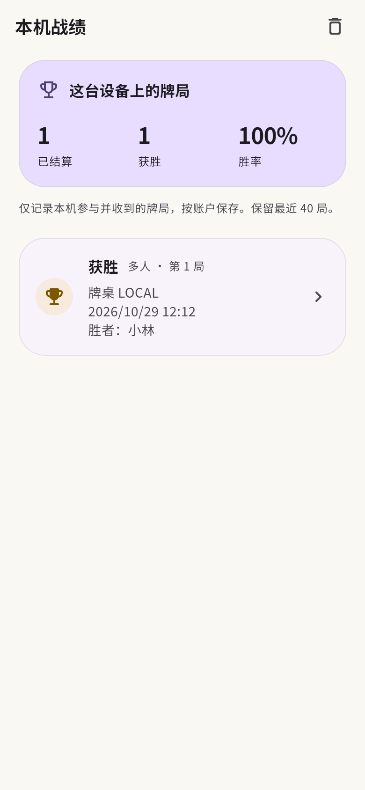
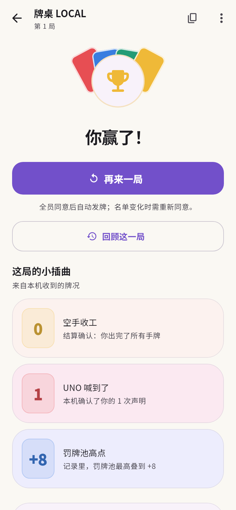
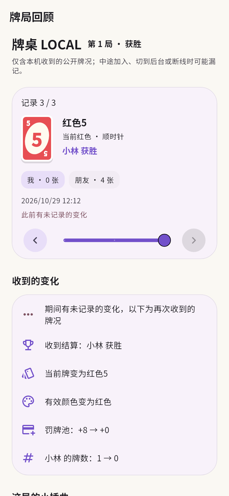
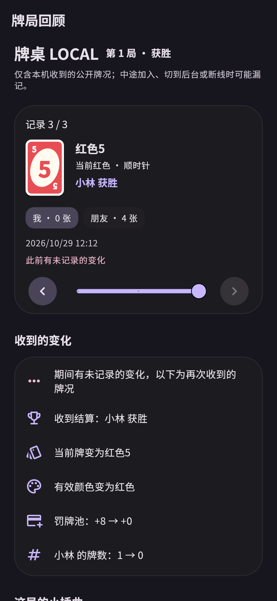

# 本机战绩、花絮与回顾

从首页「本机战绩」查看记录。点击一局进入回顾；牌桌菜单的「本局回顾」和
结算页的「回顾这一局」也可打开。功能使用现有房间快照，不需要服务端修改。

## 战绩

只在本机以玩家身份收到 `playing` 状态时开始记录，之后收到同一局的 `finished`
才计入已结算与胜率。胜者使用服务端 `winner`；无胜者单独标记。
未结算、主动退出后未收到结果、观战和直接打开旧结算页面都不制造胜负。
含电脑的牌局会标注，当前汇总包含人机与多人。

按账户隔离保存在本机 SharedPreferences，退出登录保留记录，切换账户切换记录。
用房间、创建时间、局数和本人座位去重，同局刷新与重开页面不会增加战绩，
下一局单独记录。不补录启用此版本前的牌局，不提供跨设备同步。

最多保存最近 40 局，每局最多 96 条公开牌况。超过限制时保留首条和最近 95 条，
标记被省略的区间；总记录超过 2 MiB 时先移除最旧的牌局。
变化约每 700 毫秒批量写入，结算、切到后台及关闭牌桌时立即安排保存。
本机存储写入失败会在战绩页提示重试，不影响出牌。

战绩页右上角可以清空当前账户的记录，清空正在记录的局后也不会被下一次轮询重新添加，
下一局恢复正常记录。清空不影响其他账户，也不退出线上房间。

## 结算花絮

结算时展开四色牌扇、短暂纸屑与分段滑入的花絮卡；动画结束后停止。
同一结算的普通状态更新不重播，应用与系统的「减少动态效果」直接展示最终状态。
「再来一局」位于花絮前面。

只展示能由收到的数据确认的内容：本人空手获胜、观察到的 UNO 声明、
罚牌池高点、本人最低手牌数、相邻记录中的方向变化、记录里出现的较多手牌等。
UNO 窗口编号只用来识别新声明，不作为声明次数。
版本跳跃不推断具体出牌、摸牌原因、连击次数或漏掉的反转，未取得的数据不生成成就。

## 简版回顾

通过滑块、前后按钮或时间线选择牌况，展示当时的当前牌、有效颜色、方向、
罚牌池、出牌者及各玩家牌数。查看进行中的局时默认跟随最新记录；
选中旧记录后保持位置，可按「最新」恢复跟随。

记录以本机接收时间为准，只说明公开状态的差异，不是完整动作回放。
中途加入、切到后台、断线、重启或版本跳跃可能漏记，界面标明已知缺口。
Android 原生后台通知的读取不额外写入这里；恢复前台时只记录再次收到的状态。
房间已进入下一局而客户端没有收到上一局结算时，上一局继续标为未结算。

持久化内容采用白名单：公开当前牌、牌数、玩家名称与座位、公开 UNO 标记及结果等。
不保存完整房间响应、本人或他人的手牌面、Cookie、房间 token、头像链接和合法动作列表。
回顾只读，不调用出牌或其他动作接口。

## 界面预览

以下图片使用 Flutter 组件测试的内存数据渲染，没有注册账户或创建线上牌局。

## 验证

静态检查与 78 项测试通过。新增覆盖结算去重、观战排除、未结算分母、连续开局、
账户隔离、重启恢复、内容脱敏、记录截断、清空后的刷新、持续更新时写入、
损坏记录读取、花絮依据、缺口描述、时间线切换及小屏大字体布局。
真实服务的手动检查见 [验收清单](acceptance.md)。
