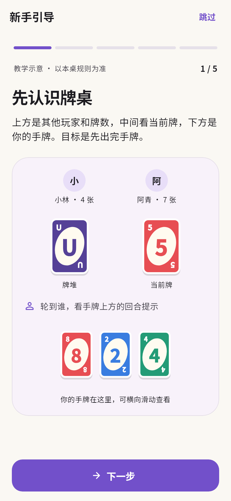
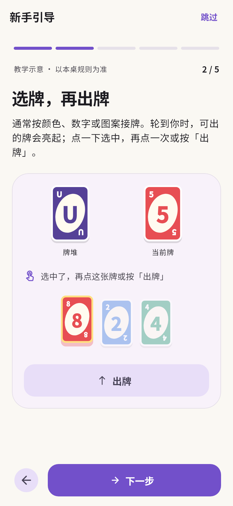
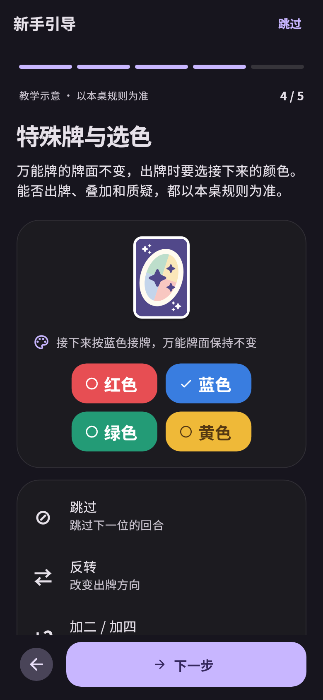
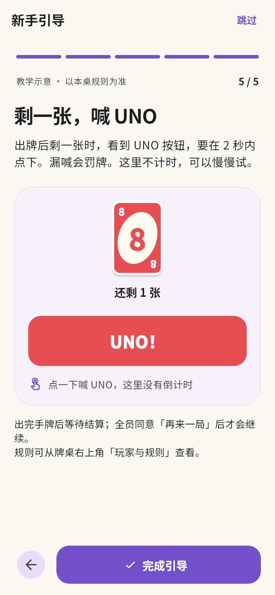

# 新手引导

不需要登录即可学习。从登录页「第一次玩？看看怎么玩」、新玩家首页的「看看怎么玩」
或「设置 → 新手引导」进入。

首页只在没有当前牌桌、最近牌桌和本机战绩时显示学习提示，不自动弹出教学页。
点击「我会玩了」、引导中的「跳过」或「完成引导」后，在本机记住选择，收起首页提示。
设置和登录页的入口始终保留。直接按返回键保留原来的完成状态。

## 五步内容

1. 认识牌桌：其他玩家与牌数、牌堆、当前牌、回合提示和横排手牌的位置。
2. 选牌再出牌：点红色 8 选中，再次点击或按「出牌」确认，可重试。
3. 摸牌与过牌：固定示例中摸到不能接的牌，原摸牌按钮在相同位置变为「过牌」。
4. 特殊牌与选色：选择万能牌的有效颜色，保留物理牌面；介绍跳过、反转和加牌。
5. 剩一张喊 UNO：练习按钮，说明正式牌局的两秒窗口和漏喊罚牌，并提示结算、再来一局及规则入口。

可用底部按钮、左右滑动和顶部步骤条切换，不要求完成示例后才能继续。
内容较长时可上下滚动，底部导航保持可见；支持深浅主题、大字体和减少动态效果。
返回后保留登录表单或设置页面，不自动开房或加入游戏。

所有示例均为固定界面演示，不提供规则引擎、离线牌局或机器人。
教学按钮不调用真实动作、没有 UNO 罚牌倒计时，也不记入本机战绩。
颜色匹配、摸后出牌、过牌、叠加与质疑可能因房间配置不同，实际以本桌规则及可用操作为准。

## 预览

以下是 Flutter 组件渲染，没有使用线上账号或房间。

## 验证

静态检查及 87 项测试通过。新增 9 项覆盖未登录访问、跳过与本机记忆、设置重看、
已有玩家不显示首页提示、选牌确认、摸牌与过牌原位切换、万能牌保留牌面、
UNO 示例不计时、不调用游戏 API，以及小屏大字体和减少动态效果。
真机上的滑动、读屏和触摸体验仍需按 [验收清单](acceptance.md) 手动检查。

2026-10-29，提交 `7972ad5` 的 [Android／iOS 手动构建](https://github.com/Leonmmcoset/unour-app/actions/runs/40877447037)
已通过，APK 与未签名 IPA 上传至 Actions，保留至 2026-11-01（UTC）。
已核对 IPA 中主应用和实时活动扩展均未签名，版本一致；未执行线上账号或牌局测试。
