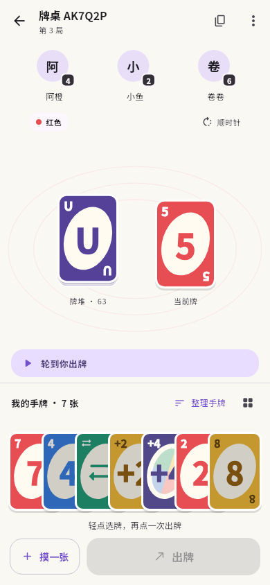
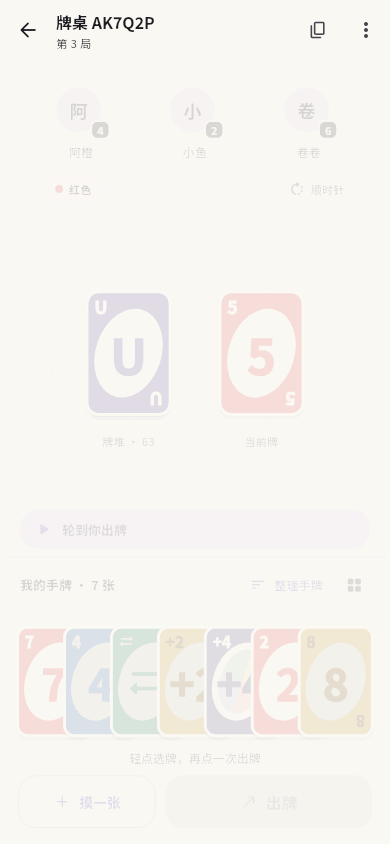
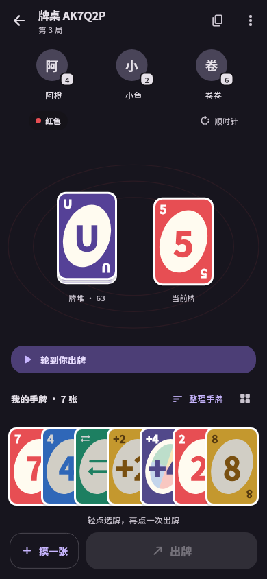

# 界面与动画

以上预览由 Flutter 界面以离线测试状态渲染。
另见[小屏过牌状态](images/table-pass-small.png)。

布局参考 [Unour 网页端](https://csac.chat/) 的玩家、牌堆和手牌位置关系，
配色、牌面和控件继续使用应用的 Material You 风格。

对手头像与剩余牌数排列在顶部，人数少时均匀分布，人数多时横向滚动。
中央并排放置牌堆和当前牌，颜色与方向放在上方，回合提示放在手牌上方。
桌面用淡色线条连接各区域，摸牌在左、出牌在右。UNO 按钮浮在中央，避免挤动手牌和操作区。
牌堆与当前牌的牌面大小一致、上下边缘对齐，说明文字也处于同一水平线。
摸牌后若服务端允许过牌，左侧按钮原位变为「过牌」，不在底部新增一行；
按钮宽度和手牌位置保持不变。

手牌等距横排，牌面保持竖直、局部重叠；390 宽度下可以同时看到七张牌，
少量手牌居中，更多手牌横向滚动。选中只抬高并完整露出该牌，不改变牌宽、间距或邻牌位置，
再次点击或按「出牌」确认。选到屏幕外的牌时，只滚动到能完整看到它的位置。
同一局中保留原有手牌顺序，新摸到的牌追加到末尾；「整理手牌」按颜色、数字与类型排列，
并可切回原始顺序。网格按钮打开全部手牌，沿用当前整理方式。

小屏采用较小的牌面；较大字体或额外的质疑按钮需要更多空间时，可纵向滚动。

## 动画

- 入口分批淡入、滑入并轻微回弹；按钮按压后回弹。
- 手牌选中抬起，摸牌滑入，出牌后邻牌平滑补位，整理时平滑换位。
- 当前牌以滑入、缩放和回弹切换；回合、手牌数量和出牌方向分别过渡。
- 结算以四色牌扇回弹展开，短暂纸屑和花絮卡依次出现，结束后停止。

动画使用三次缓动与 `easeOutBack`，通过牌 ID、局数等状态标识触发。
重复收到相同状态不会重播动画。退场中的牌会屏蔽触摸和辅助功能焦点。
应用或系统开启「减少动态效果」时直接呈现最终状态。

## 验证

静态检查与 87 项测试通过。组件测试覆盖固定间距、选中时牌宽和邻牌位置不变、
选中牌不被裁切、状态更新不打乱顺序、增减牌、整理与恢复、屏幕外选牌、相同牌面不重播、
退场牌不可操作，以及动画途中开启减少动态效果。
布局测试覆盖七张手牌可见、UNO 不挤动手牌、观战布局，以及 320×640、十位玩家、
40 张手牌、1.6 倍字体和深浅主题。
另检查两种手机尺寸的牌堆对齐，以及开关动画时摸牌／过牌原位切换、不增加纵向滚动。

另已渲染检查首页、牌桌、选牌、设置、登录、加入牌桌、账户和结算页面。
真实手机上的流畅度、触摸体验和真实牌局仍按 [验收清单](acceptance.md) 手动检查。

本机战绩、结算花絮和回顾页的预览及记录边界见 [本机记录](local-history.md)。
新手引导沿用游戏牌面、整齐横排手牌及原位摸牌／过牌操作，见 [教学预览](tutorial.md)。
